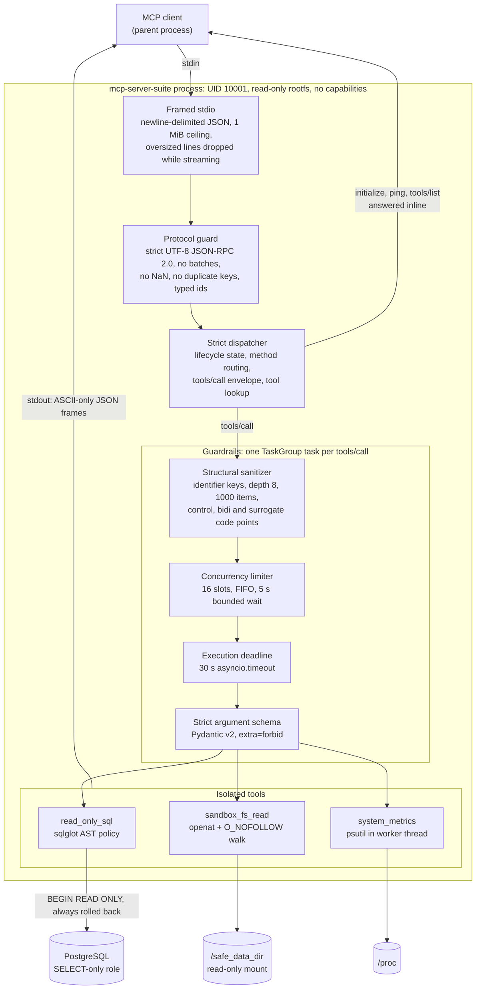
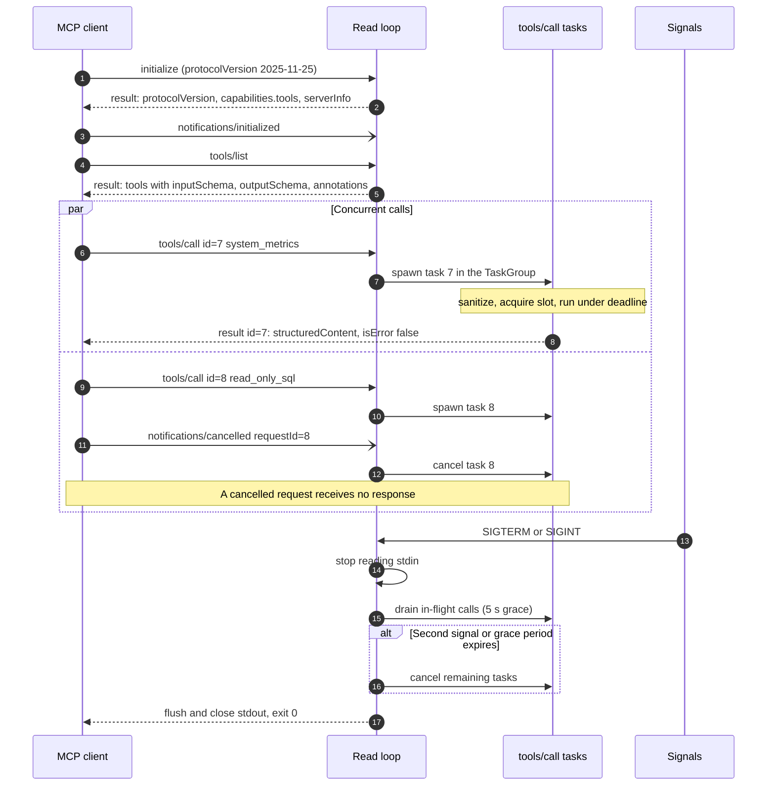

# mcp-server-suite

A hardened [Model Context Protocol](https://modelcontextprotocol.io) (MCP) server that
speaks JSON-RPC 2.0 over standard I/O and exposes three narrowly scoped tools:

| Tool              | Purpose                                                    |
| ----------------- | ---------------------------------------------------------- |
| `read_only_sql`   | One validated, row-capped `SELECT` against PostgreSQL      |
| `sandbox_fs_read` | Bounded text reads confined to a single directory tree     |
| `system_metrics`  | Host CPU, memory and disk utilisation                      |

The server is designed to be launched by an MCP client as a child process, inside an
unprivileged container with a read-only root filesystem.

## Design tenets

- **Fail closed.** Every input crosses a strict schema (`extra="forbid"`, strict types,
  no NaN/Infinity). Anything the policy does not explicitly allow is rejected with a
  machine-readable RFC 9457 problem.
- **Structured concurrency.** One `asyncio.TaskGroup` owns every task in a session. Each
  `tools/call` is a child task that can be cancelled, deadline-bounded and drained on
  shutdown. No task outlives the session.
- **No runtime network dependencies.** The transport is stdio. The only outbound
  connection the server can make is to the PostgreSQL DSN you configure, and the shipped
  Compose profile has networking disabled.
- **Defence in depth.** Each control assumes the one before it failed. The SQL AST policy
  is backed by read-only transactions and a least-privilege role. Path resolution is
  backed by a race-free `openat` walk. The container adds a non-root UID, no capabilities
  and an immutable root filesystem.

## Contents

- [Quickstart](#quickstart)
- [Architecture](#architecture)
- [Session lifecycle and concurrency](#session-lifecycle-and-concurrency)
- [Wire specification](#wire-specification)
- [Tool contracts](#tool-contracts)
- [Error model](#error-model)
- [Threat model (STRIDE)](#threat-model-stride)
- [Configuration](#configuration)
- [Operations](#operations)
- [Repository layout](#repository-layout)
- [Contributing](#contributing)
- [License](#license)

## Quickstart

```bash
# Container (recommended)
docker compose build
printf '%s\n' \
  '{"jsonrpc":"2.0","id":1,"method":"initialize","params":{"protocolVersion":"2025-11-25","capabilities":{},"clientInfo":{"name":"cli","version":"1"}}}' \
  '{"jsonrpc":"2.0","method":"notifications/initialized"}' \
  '{"jsonrpc":"2.0","id":2,"method":"tools/list"}' |
  docker compose run --rm -T mcp-server

# From source (Python 3.12, uv)
uv sync
mkdir -p data
MCP_SAFE_DATA_DIR="$PWD/data" uv run mcp-server-suite
```

The server reads requests from stdin until EOF or `SIGINT`/`SIGTERM`. Responses go to
stdout and logs go to stderr.

## Architecture



| Layer               | Module                          | Guarantees                                                                                                                                                                                     |
| ------------------- | ------------------------------- | ---------------------------------------------------------------------------------------------------------------------------------------------------------------------------------------------- |
| Framed stdio        | `core/framing.py`, `core/stdio.py` | Memory bounded by frame limit + one 64 KiB chunk. An over-long line is discarded as it streams and reported once, then reading resumes at the next newline. Output is `ensure_ascii` JSON, so lone surrogates cannot break encoding. |
| Protocol guard      | `core/jsonrpc.py`               | Rejects invalid UTF-8, `NaN`/`Infinity` literals, duplicate object keys, pathological nesting, batches, non-string/integer ids and unknown envelope members.                                  |
| Dispatcher          | `core/server.py`                | Enforces the `initialize` handshake before other methods, rejects duplicate in-flight ids, validates the `tools/call` envelope and the tool name before any tool code runs.                    |
| Guardrails          | `guardrails/`                   | Sanitizer, then concurrency slot, then deadline. Every rejection is an in-band problem the model can act on.                                                                                    |
| Argument schema     | `core/registry.py`, `schemas/`  | Arguments are validated in JSON mode against frozen, strict Pydantic models. Results are re-checked against the tool's output contract.                                                     |
| Tools               | `tools/`                        | Each tool carries its own isolation controls (see [Tool contracts](#tool-contracts)).                                                                                                         |

## Session lifecycle and concurrency



- `initialize`, `ping` and `tools/list` are answered inline, in arrival order. Each
  `tools/call` runs as its own task, so a slow tool never blocks the read loop and
  responses may arrive out of order (match them by `id`).
- `notifications/cancelled` cancels the matching task. Per the MCP specification, a
  cancelled request gets no response.
- EOF on stdin, `SIGINT` and `SIGTERM` all start the same graceful drain. A second signal
  cancels in-flight work immediately. A write failure on stdout (client gone) also
  triggers shutdown.
- Blocking work (file reads, CPU sampling) runs in worker threads via `asyncio.to_thread`,
  so it never stalls the event loop.

## Wire specification

**Transport.** One JSON-RPC 2.0 message per line (`\n`-terminated, an optional trailing
`\r` is tolerated, blank lines are ignored). The maximum frame size is 1 MiB (1,048,576
bytes). Larger lines get a `-32600` error with `"data": {"max_frame_bytes": 1048576}` and
the session continues.

**Protocol versions.** `2025-11-25`, `2025-06-18`, `2025-03-26` and `2024-11-05`. A client
requesting any other version is offered `2025-11-25`, per the MCP negotiation rules.

| Method                      | Kind         | Before `initialize` | Notes                                                    |
| --------------------------- | ------------ | ------------------- | -------------------------------------------------------- |
| `initialize`                | request      | yes                 | Exactly once per session                                 |
| `ping`                      | request      | yes                 | Returns `{}`                                             |
| `tools/list`                | request      | no                  | `inputSchema`, `outputSchema` and annotations per tool   |
| `tools/call`                | request      | no                  | Concurrent; see [Error model](#error-model)              |
| `notifications/initialized` | notification | n/a                 | Marks the client ready                                   |
| `notifications/cancelled`   | notification | n/a                 | Cancels an in-flight `tools/call` by `requestId`         |

Unknown notifications are ignored. Unknown methods return `-32601`. Responses sent by the
client are ignored, because the server issues no requests of its own.

## Tool contracts

Every tool is advertised with `readOnlyHint: true`, `destructiveHint: false`,
`idempotentHint: true` and `openWorldHint: false`. Successful calls return the result as
both JSON `structuredContent` and an identical JSON text block.

### `read_only_sql`

Registered only when `MCP_SQL_DSN` is set.

| Argument   | Type    | Constraints                       | Default |
| ---------- | ------- | --------------------------------- | ------- |
| `query`    | string  | 6–10,000 chars, no NUL, not blank | —       |
| `max_rows` | integer | 1–50                              | 50      |

| Result      | Type                 | Meaning                                                      |
| ----------- | -------------------- | ------------------------------------------------------------ |
| `columns`   | string[]             | Column names in result order                                 |
| `rows`      | array[] (≤ 50)       | Values normalised to JSON: `Decimal`/`UUID` as text, timestamps ISO 8601, `bytea` as `\x…` hex |
| `row_count` | integer              | Equals `len(rows)`                                           |
| `truncated` | boolean              | `true` when the server cap, not the query, bounded the rows  |

How a query is enforced:

1. **Single statement.** The query is parsed with sqlglot (PostgreSQL dialect). More
   than one statement is a `MCP_QUERY_VIOLATION`.
2. **Root and tree policy.** The root must be a `SELECT` or a set operation
   (`UNION`/`INTERSECT`/`EXCEPT`). The *entire* AST is walked, so a write hidden in a CTE
   (`WITH d AS (DELETE …) SELECT …`) is rejected. Rejected nodes include DML, DDL,
   `DROP`, `ALTER`, `TRUNCATE`, `GRANT`/`REVOKE`, `SET`, transaction control,
   `SELECT INTO`, row locks (`FOR UPDATE`) and anything sqlglot models only as an opaque
   command (`DO`, `CALL`, `COPY`, `VACUUM`, …).
3. **Function denylist.** Functions with effects that survive a rolled-back read-only
   transaction are rejected: `dblink*`, `lo_*`, advisory locks, `pg_sleep`,
   `pg_read_file`, `pg_ls_*`, `pg_terminate_backend`, `set_config`, `pg_notify`,
   replication and WAL control, among others. Bind parameters are rejected (inline
   literals instead).
4. **Deterministic LIMIT.** The outer `LIMIT` is rewritten to `min(literal, max_rows)`.
   A missing, non-literal, `ALL`, `PERCENT` or `WITH TIES` limit becomes `LIMIT max_rows`.
   The SQL actually executed is regenerated from the validated AST (comments dropped)
   and validated a second time.
5. **Execution.** The query runs inside `BEGIN READ ONLY` with a transaction-local
   `statement_timeout`, and the transaction is **always rolled back**. Pooled
   connections also default to `default_transaction_read_only=on`.

| Input                                                  | Outcome                                                 |
| ------------------------------------------------------ | ------------------------------------------------------- |
| `SELECT id, name FROM users`                           | Executes `SELECT id, name FROM users LIMIT 50`          |
| `SELECT * FROM t LIMIT 10`                             | Executes `SELECT * FROM t LIMIT 10`                     |
| `SELECT * FROM t LIMIT 500`                            | Executes `SELECT * FROM t LIMIT 50`                     |
| `SELECT 1; DROP TABLE t`                               | `MCP_QUERY_VIOLATION`: exactly one statement is allowed |
| `WITH d AS (DELETE FROM t RETURNING *) SELECT * FROM d` | `MCP_QUERY_VIOLATION`: DELETE is not allowed           |
| `SELECT pg_sleep(10)`                                  | `MCP_QUERY_VIOLATION`: function pg_sleep() is not allowed |

PostgreSQL errors caused by the query are mapped in-band: `57014` (statement timeout) to
`MCP_EXECUTION_TIMEOUT`, `25006` (read-only violation) to `MCP_QUERY_VIOLATION`, `42501`
to `MCP_ACCESS_DENIED`, and SQLSTATE classes `21`, `22`, `42`, `0A` and `54` to
`MCP_VALIDATION_ERROR`. Connection and server failures are infrastructure faults
(`-32603`).

### `sandbox_fs_read`

Registered only when `MCP_SAFE_DATA_DIR` is set (the container image sets it to
`/safe_data_dir`).

| Argument        | Type    | Constraints                                  | Default |
| --------------- | ------- | -------------------------------------------- | ------- |
| `relative_path` | string  | 1–4,096 chars, no NUL                        | —       |
| `encoding`      | string  | A Python **text** codec (`base64`, `zlib`, `rot13` are rejected) | `utf-8` |
| `max_bytes`     | integer | 1–1,048,576                                  | 65,536  |

| Result          | Type    | Meaning                                                   |
| --------------- | ------- | --------------------------------------------------------- |
| `resolved_path` | string  | Canonical path **relative to the sandbox root**           |
| `content`       | string  | Strictly decoded text                                     |
| `bytes_read`    | integer | Bytes decoded. A multi-byte character cut by `max_bytes` is dropped |
| `truncated`     | boolean | The file is longer than `max_bytes`                       |

How a read is enforced:

1. **Canonical containment.** `(root / relative_path).resolve()` follows every symlink
   and the result must satisfy `is_relative_to(root)`. Resolution is non-strict, so a
   path outside the sandbox is denied whether or not it exists (no existence oracle).
   Symlink loops are rejected.
2. **Race-free open.** The resolved path is re-opened one component at a time with
   `openat` relative to a directory fd, using `O_NOFOLLOW` on every component. A
   directory swapped for a symlink between steps 1 and 2 fails with `ELOOP` and cannot
   escape. Symlinks that resolve *inside* the sandbox are followed by step 1, so the walk
   itself never meets one.
3. **File type.** The leaf is opened `O_NONBLOCK | O_NOCTTY` and checked with `fstat` on
   the open descriptor. Only regular files are read. FIFOs, sockets and character or
   block devices are denied, and a FIFO cannot hang the worker.
4. **Bounded read.** At most `max_bytes + 1` bytes are read, in a worker thread, then
   strictly decoded.
5. **No path leaks.** Problems echo at most 256 characters of the caller's own
   `relative_path` and never an absolute host path.

### `system_metrics`

Registered unless `MCP_METRICS_ENABLED=false`.

| Argument       | Type    | Default |
| -------------- | ------- | ------- |
| `include_disk` | boolean | `false` |

| Result              | Type                                                     |
| ------------------- | -------------------------------------------------------- |
| `cpu`               | `utilization_percent` (0–100), `core_count` (≥ 1), `load_average_1m` (≥ 0) |
| `memory`            | `total_bytes`, `available_bytes` (≤ total), `percent_used` (0–100) |
| `disk_percent_used` | 0–100 for `MCP_METRICS_DISK_PATH`, or `null` when not requested |
| `timestamp_utc`     | ISO 8601 timestamp with a zero UTC offset                |

Readings are clamped into range, because containers and VMs occasionally report slightly
out-of-range values. The disk path is configuration only and is never echoed back.

## Error model

MCP distinguishes two failure channels, and this server uses them deliberately:

- **In-band tool errors** (`result.isError: true`). The tool ran (or was refused) because
  of what the caller asked for: invalid arguments, a policy violation, a denied path, a
  timeout or a full concurrency queue. The result carries one text block whose content is
  an RFC 9457 problem document. The calling model can read it, correct the arguments and
  retry. `structuredContent` is omitted because it would not match the tool's
  `outputSchema`.
- **Transport-level JSON-RPC errors** (`error`). The *message* is wrong rather than the
  tool call: unparsable JSON, an invalid envelope, an unknown method, a call before
  `initialize`, an unknown tool name or a malformed `tools/call` envelope. Unexpected
  crashes inside a tool also land here as `-32603`. The traceback goes to stderr and the
  client sees only a generic message.

| `MCPErrorCode`          | RFC 9457 `type`                                  | HTTP status | JSON-RPC code | Typical cause                                  |
| ----------------------- | ------------------------------------------------ | ----------- | ------------- | ---------------------------------------------- |
| `MCP_VALIDATION_ERROR`  | `urn:mcp-server-suite:problem:validation-error`  | 422         | `-32602`      | Schema violation, SQL syntax, missing file, sanitizer rejection |
| `MCP_ACCESS_DENIED`     | `urn:mcp-server-suite:problem:access-denied`     | 403         | `-32001`      | Path outside the sandbox, special file, SQL `42501` |
| `MCP_QUERY_VIOLATION`   | `urn:mcp-server-suite:problem:query-violation`   | 403         | `-32002`      | Write, multi-statement or denylisted function  |
| `MCP_EXECUTION_TIMEOUT` | `urn:mcp-server-suite:problem:execution-timeout` | 504         | `-32003`      | Tool deadline or PostgreSQL `statement_timeout` |
| `MCP_INTERNAL_ERROR`    | `urn:mcp-server-suite:problem:internal-error`    | 500         | `-32603`      | Concurrency queue full (`metadata.retryable: true`) or crash |

The JSON-RPC code is used when a problem travels as `error.data`, for example an unknown
tool name, which is reported as `-32602` with the problem attached. `type` and `status`
are validated against the code, so the same code can never be emitted with conflicting
semantics. The other JSON-RPC codes are the standard ones: `-32700` parse error,
`-32600` invalid request, `-32601` method not found.

In-band error (path traversal attempt):

```json
{"jsonrpc":"2.0","id":3,"result":{"isError":true,"content":[{"type":"text",
 "text":"{\"type\": \"urn:mcp-server-suite:problem:access-denied\", \"title\": \"Access to the requested resource is denied\", \"status\": 403, \"detail\": \"'../../etc/passwd' resolves outside the sandbox\", \"code\": \"MCP_ACCESS_DENIED\", \"invalid_params\": [\"relative_path\"], \"metadata\": {}}"}]}}
```

Protocol error (unknown tool):

```json
{"jsonrpc":"2.0","id":4,"error":{"code":-32602,"message":"Unknown tool: 'no_such_tool'",
 "data":{"type":"urn:mcp-server-suite:problem:validation-error","title":"Invalid tool arguments",
 "status":422,"detail":"Unknown tool: 'no_such_tool'","code":"MCP_VALIDATION_ERROR",
 "invalid_params":["name"],"metadata":{}}}}
```

## Threat model (STRIDE)

**Assets.** Database contents and integrity, files on the host outside the sandbox, host
availability, and the integrity of the published source.

**Trust boundaries.**

1. The MCP client and the model driving it, which supply all tool arguments. These are
   treated as untrusted, including prompt-injected input.
2. The process boundary, which the container hardens.
3. The PostgreSQL server.
4. The source supply chain (commits, dependencies, base images, CI actions).

MCP over stdio has no authentication of its own: whoever can spawn the process is the
client. Access control is therefore the job of the launching environment, the mounted
data and the database role.

| Threat | Attack vector | Controls | Verified by |
| ------ | ------------- | -------- | ----------- |
| **Spoofing** | Commits published under a forged or tool-attributed identity. | Sole-committer invariant (`.githooks/_policy.sh`) checked on author *and* committer by `pre-commit`, `commit-msg` and `pre-push`. The same rules run in CI (`scripts/audit-attribution.sh` on the push or PR range). Tool-generated trailers are rejected. Local identity is pinned with `user.useConfigOnly`. | `tests/unit/test_policy_parity.py`, `attribution-audit` job |
| **Tampering** | SQL injection or write smuggling: stacked statements, writes in CTEs, `SELECT INTO`, row locks, side-effecting functions, comment tricks, unbounded result sets. | sqlglot AST walk over the whole tree. Single-statement rule. Root must be `SELECT` or a set operation. Function denylist. Executed SQL regenerated from the AST and re-validated. Deterministic `LIMIT ≤ 50`. `BEGIN READ ONLY` plus unconditional rollback. Read-only session defaults. SELECT-only database role (below). | `test_sql_tool.py`, Hypothesis grammar and attack fuzzing in `test_fuzz.py` |
| **Tampering** | Argument poisoning: bidi overrides (Trojan Source), zero-width characters, control characters, dunder or non-identifier keys. | Structural sanitizer runs before schema validation. Strict Pydantic models with `extra="forbid"`. | `test_guardrails.py`, sanitizer fuzzing against `unicodedata` |
| **Repudiation** | A call that cannot be traced afterwards. | Errors and lifecycle events are logged to stderr (`MCP_SERVER_SUITE_LOG_LEVEL`). Unexpected crashes are logged with a traceback. There is no per-call audit log; capture stderr in the launching environment if you need one. | — |
| **Information disclosure** | Path traversal (`../`, absolute paths, symlink escapes, TOCTOU symlink swaps), reading devices or FIFOs, probing for file existence, host paths leaking in errors. | Non-strict canonical resolution plus `is_relative_to` (no existence oracle). Race-free `openat` walk with `O_NOFOLLOW` per component. `fstat` regular-file check on the open fd. `O_NONBLOCK`/`O_NOCTTY` leaf open. Problems carry only the caller's relative path. Internal errors are reported generically. | `test_fs_tool.py`, traversal fuzzing against a `realpath` oracle |
| **Information disclosure** | Credentials or data leaking through the server. | The DSN is a `SecretStr` (redacted in reprs). The shipped Compose profile has `network_mode: none`. The CI Trivy scan includes secret detection. | `container-security` job |
| **Denial of service** | Memory exhaustion via giant lines, crashing the session with lone UTF-16 surrogates, deeply nested JSON or SQL, call floods, slow tools, blocking I/O. | 1 MiB frame ceiling, enforced while streaming. Surrogates are rejected by the sanitizer and Pydantic, and output is ASCII-escaped. Nesting depth and size limits, with parser `RecursionError` mapped to a validation error. 16-slot FIFO limiter with a bounded wait. 30 s per-call deadline plus PostgreSQL `statement_timeout`. File reads and CPU sampling offloaded to threads. Container CPU, memory and PID limits. | `test_core.py`, `test_guardrails.py`, e2e subprocess tests |
| **Elevation of privilege** | A compromised tool or dependency gaining root, capabilities or persistence. | Non-root UID/GID `10001:10001`. Read-only root filesystem with `tmpfs` `/tmp` (`noexec,nosuid,nodev`). `--cap-drop ALL`. `no-new-privileges`. setuid/setgid bits stripped. pip, ensurepip, apt and dpkg removed from the image. `PYTHONSAFEPATH=1`. Base images and CI actions pinned by digest/SHA. | `scripts/smoke-docker.sh`, Trivy in CI |

### Residual risks and limitations

- The SQL policy is a denylist over a parser's model of SQL, so it is a filter, not an
  isolation boundary. The database role is the boundary: give it `SELECT` on exactly the
  objects the model may see.
- A deadline cancels the awaiting task immediately, but Python cannot interrupt a
  worker thread. Thread work is kept short by design: reads are capped and CPU sampling
  is ≤ 2 s.
- Content returned by tools is data, not instructions. Clients should present it to
  models accordingly.

## Configuration

All settings are environment variables, validated at startup. Invalid values stop the
server rather than being silently replaced.

| Variable                           | Default            | Constraint             | Effect                                         |
| ---------------------------------- | ------------------ | ---------------------- | ---------------------------------------------- |
| `MCP_SQL_DSN`                      | unset              | `postgres://` or `postgresql://` | Enables `read_only_sql`               |
| `MCP_SQL_CONNECT_TIMEOUT`          | `5`                | > 0, ≤ 60 s               | Connect and pool-acquire timeout               |
| `MCP_SQL_QUERY_TIMEOUT`            | `10`               | > 0, ≤ 300 s               | Client timeout and server `statement_timeout`  |
| `MCP_SQL_POOL_MAX_SIZE`            | `4`                | 1–32                   | Maximum pooled connections (created lazily)    |
| `MCP_SQL_APPLICATION_NAME`         | `mcp-server-suite` | 1–63 chars             | `application_name` seen in `pg_stat_activity`  |
| `MCP_SAFE_DATA_DIR`                | unset (`/safe_data_dir` in the image) | absolute, existing directory | Enables `sandbox_fs_read` |
| `MCP_METRICS_ENABLED`              | `true`             | boolean                | Enables `system_metrics`                       |
| `MCP_METRICS_CPU_SAMPLE_SECONDS`   | `0.1`              | > 0, ≤ 2 s               | CPU sampling interval                          |
| `MCP_METRICS_DISK_PATH`            | `/`                | absolute path          | Filesystem reported by `disk_percent_used`     |
| `MCP_MAX_CONCURRENT_TOOLS`         | `16`               | 1–256                  | Concurrent `tools/call` slots                  |
| `MCP_TOOL_ACQUIRE_TIMEOUT_SECONDS` | `5`                | 0–60 s                 | Wait for a slot before rejecting (`0` = reject immediately) |
| `MCP_TOOL_TIMEOUT_SECONDS`         | `30`               | > 0, ≤ 600 s               | Per-call execution deadline                    |
| `MCP_MAX_ARGUMENT_DEPTH`           | `8`                | 1–64                   | Maximum nesting of tool arguments              |
| `MCP_MAX_ARGUMENT_ITEMS`           | `1000`             | 1–100,000              | Maximum items in any argument container        |
| `MCP_SERVER_SUITE_LOG_LEVEL`       | `WARNING`          | logging level name     | stderr log verbosity                           |

## Operations

### Local development

Prerequisites: [uv](https://docs.astral.sh/uv/) and, optionally,
[direnv](https://direnv.net/). The `.envrc` keeps every cache, the virtualenv and
temporary files under `./.cache/`, and configures the git hooks and identity.

```bash
direnv allow                 # once; or export the variables from .envrc manually
uv sync --locked             # Python 3.12 + locked dependencies into .cache/venv

ruff check . && ruff format --check .
mypy src/ tests/ --strict
bandit -c pyproject.toml -r src/
pytest                       # sockets disabled, branch coverage, >= 95% floor
scripts/coverage-gate.sh     # 100% branch coverage on tools/sql.py, tools/fs.py, guardrails/
```

The test suite is hermetic. `pytest-socket` blocks all IP sockets for the whole run
(Unix sockets stay available for the event loop), no test needs a live database, and
`MCP_*` variables are cleared around each test. The suite covers:

- **Unit:** contracts and controls.
- **Property-based:** Hypothesis fuzzing, `tests/unit/test_fuzz.py`.
- **End-to-end:** the real server as a subprocess under `python -X dev`,
  `tests/e2e/`. These cover handshakes, concurrency, malformed input, oversized frames,
  signals and file-descriptor/task leak checks.

```bash
HYPOTHESIS_PROFILE=ci pytest tests/unit/test_fuzz.py --no-cov   # 1000 derandomised examples per property
pytest -m e2e --no-cov                                           # subprocess protocol tests only
```

**Mutation checks.** The repository ships no mutation-testing script or framework, so
mutation checks are run by hand. Disable one defence, run its test module, confirm it
fails, then restore the file. For example:

```bash
# Drop O_NOFOLLOW from the directory walk: test_fs_tool.py must fail.
sed -i.bak 's/os.O_DIRECTORY | os.O_NOFOLLOW/os.O_DIRECTORY/' src/mcp_server_suite/tools/fs.py
pytest tests/unit/test_fs_tool.py --no-cov; mv src/mcp_server_suite/tools/fs.py.bak src/mcp_server_suite/tools/fs.py

# Skip the LIMIT rewrite: test_sql_tool.py must fail.
sed -i.bak 's/root.limit(effective, copy=False).sql/root.sql/' src/mcp_server_suite/tools/sql.py
pytest tests/unit/test_sql_tool.py --no-cov; mv src/mcp_server_suite/tools/sql.py.bak src/mcp_server_suite/tools/sql.py

git diff --exit-code src/    # confirm the tree is restored
```

### Container deployment

The image is a two-stage build:

- **Builder:** `python:3.12-slim` with uv installs the locked dependencies and the
  package into `/opt/venv`.
- **Runtime:** the same digest-pinned base, with no pip, uv, compilers or package
  managers. It runs as `10001:10001` with `STOPSIGNAL SIGTERM`.

```bash
docker build -t mcp-server-suite:local .

docker run --rm -i \
  --read-only \
  --cap-drop ALL \
  --security-opt no-new-privileges:true \
  --network none \
  --tmpfs /tmp:rw,noexec,nosuid,nodev,size=16m \
  --pids-limit 64 --memory 256m --cpus 1 \
  -v "$PWD/data:/safe_data_dir:ro" \
  mcp-server-suite:local
```

- Mount only the directory the model should read, read-only. Files must be readable by
  UID `10001` (world-readable files in a world-traversable directory are enough).
- Keep `-i` and omit `-t`: a TTY would rewrite the newline-delimited stream.
- To use `read_only_sql`, replace `--network none` with a network that reaches only the
  database, and pass `-e MCP_SQL_DSN`. Prefer an env file or secret store to putting the
  DSN on the command line.

`docker-compose.yml` applies the same profile, with resource reservations and a
dedicated read-only `safe-data` volume:

```bash
docker compose build
docker compose run --rm -T mcp-server < requests.jsonl
```

`scripts/smoke-docker.sh` builds the image and checks the result:

- the UID is 10001;
- the root filesystem and `/opt/venv` reject writes while `/tmp` accepts them;
- pip, package managers and setuid binaries are absent;
- an MCP handshake over container stdio succeeds through both `docker run` and Compose;
- `docker stop` exits cleanly.

`--offline` validates the Dockerfile and Compose file without a daemon.

An MCP client launches the container like any stdio server:

```json
{
  "mcpServers": {
    "mcp-server-suite": {
      "command": "docker",
      "args": [
        "run", "--rm", "-i", "--read-only", "--cap-drop", "ALL",
        "--security-opt", "no-new-privileges:true", "--network", "none",
        "--tmpfs", "/tmp:rw,noexec,nosuid,nodev,size=16m",
        "-v", "mcp-safe-data:/safe_data_dir:ro",
        "mcp-server-suite:local"
      ]
    }
  }
}
```

### PostgreSQL least-privilege role

The AST policy and read-only transactions reduce risk. The role is what actually bounds
it. Create a dedicated login role that can only read the objects you intend to expose:

```sql
-- Dedicated login role: no inheritance, no special attributes.
CREATE ROLE mcp_reader LOGIN NOINHERIT NOSUPERUSER NOCREATEDB NOCREATEROLE
  NOREPLICATION NOBYPASSRLS CONNECTION LIMIT 8;
\password mcp_reader

-- Server-side defaults that hold even if a client-side layer is bypassed.
ALTER ROLE mcp_reader SET default_transaction_read_only = on;
ALTER ROLE mcp_reader SET statement_timeout = '10s';
ALTER ROLE mcp_reader SET lock_timeout = '1s';
ALTER ROLE mcp_reader SET idle_in_transaction_session_timeout = '15s';

-- Read access to one schema only; ideally a schema of curated views.
GRANT CONNECT ON DATABASE app TO mcp_reader;
GRANT USAGE ON SCHEMA reporting TO mcp_reader;
GRANT SELECT ON ALL TABLES IN SCHEMA reporting TO mcp_reader;
ALTER DEFAULT PRIVILEGES FOR ROLE app_owner IN SCHEMA reporting
  GRANT SELECT ON TABLES TO mcp_reader;
```

- Keep `CONNECTION LIMIT` at or above `MCP_SQL_POOL_MAX_SIZE`.
- Never grant membership in `pg_read_all_data`, `pg_read_server_files`,
  `pg_execute_server_program` or `pg_signal_backend`.
- Use row-level security or views to expose only the rows and columns the model needs.
- Connect with TLS (`?sslmode=verify-full`):

  ```bash
  export MCP_SQL_DSN='postgresql://mcp_reader@db.internal:5432/app?sslmode=verify-full'
  ```

### Continuous integration

`.github/workflows/ci.yml` runs on pushes to `main` and on every pull request, with
`contents: read` permissions. Every action is pinned to a commit SHA, with its version
in a comment.

| Job                  | Gates                                                                                         |
| -------------------- | --------------------------------------------------------------------------------------------- |
| `attribution-audit`  | Commit identity, subject and trailer audit of the PR or push range. Tracked-file hygiene audit. |
| `code-quality`       | ruff lint and format, `mypy --strict`, bandit, pytest with `HYPOTHESIS_PROFILE=ci` and a 95% floor, `scripts/coverage-gate.sh` |
| `container-security` | Buildx image build, `scripts/smoke-docker.sh` against the live daemon, Trivy (fails on fixable CRITICAL/HIGH, reports unfixed ones) |

## Repository layout

```text
src/mcp_server_suite/
  __main__.py        entry point: logging to stderr, stdio session
  core/              framing, JSON-RPC parsing, dispatcher, tool registry, stdio transport
  guardrails/        argument sanitizer, concurrency limiter, execution deadline
  schemas/           strict Pydantic contracts and the RFC 9457 error taxonomy
  tools/             read_only_sql, sandbox_fs_read, system_metrics
tests/
  unit/              contracts, controls, fuzzing, hermeticity, hook/CI policy parity
  e2e/               real-process stdio protocol tests
scripts/             attribution, hygiene, coverage and container smoke gates
.githooks/           pre-commit, commit-msg, pre-push (shared rules in _policy.sh)
Dockerfile, docker-compose.yml, .github/workflows/ci.yml
```

## Contributing

- Commits use [Conventional Commits](https://www.conventionalcommits.org/)
  (`type(scope): subject`) with no generated trailers.
- Author and committer must match the configured maintainer identity. The hooks in
  `.githooks/` enforce this locally (`git config core.hooksPath .githooks`, set
  automatically by `.envrc`) and CI enforces the same rules.
- Integrate changes with a fast-forward or rebase and push. Merging through the GitHub
  web UI records GitHub as the committer, which the audit rejects.
- Keep caches and temporary files under `./.cache/`. Never commit absolute machine
  paths; the hygiene gates reject them.

## License

Released under the [MIT License](LICENSE) (SPDX: `MIT`).
Copyright (c) 2026 mikeZ98.
